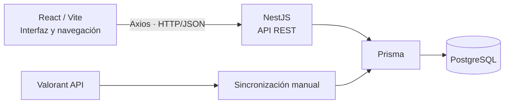
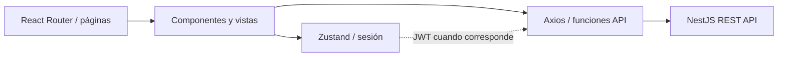
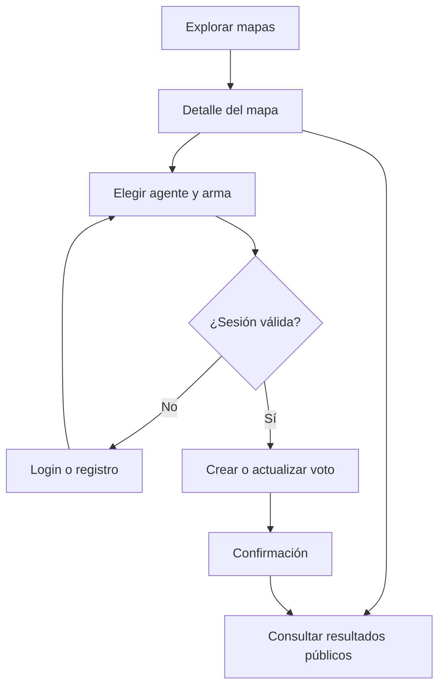
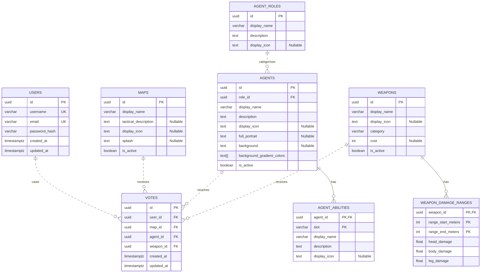

# Documentación técnica — Valorant Community

Esta documentación explica **cómo está construido el producto y por qué**. Para instalarlo, ejecutarlo o probar los endpoints, consulta el [README](README.md).

## 1. Arquitectura general

El **frontend** presenta los mapas, gestiona la sesión y permite votar. El **backend** valida las operaciones, aplica las reglas de negocio y consulta PostgreSQL. El catálogo externo se sincroniza por separado: navegar o consultar resultados no requiere llamar a Valorant API en cada petición.

## 2. Frontend

**Stack:** React, Vite, TypeScript, Tailwind CSS, shadcn/ui, Axios, Zustand, React Router y Tabler Icons.

| Parte                   | Responsabilidad                                                                               |
| ----------------------- | --------------------------------------------------------------------------------------------- |
| Páginas y rutas         | Exploración de mapas, acceso/registro y detalle de cada mapa.                                 |
| Componentes de producto | Tarjetas, vista previa, selección de agentes y armas, rankings.                               |
| shadcn/ui               | Componentes interactivos reutilizables; el diseño y las composiciones se adaptan al producto. |
| Axios                   | Peticiones a NestJS desde un cliente HTTP compartido.                                         |
| Zustand                 | Usuario, token y estado de autenticación; no se utiliza como caché del catálogo.              |
| Estado local            | Búsquedas, selecciones temporales, formularios y carga de resultados.                         |

**Autenticación.** El registro y el login reciben un JWT. La sesión se conserva con Zustand y `sessionStorage`; al restaurarla se verifica mediante `GET /api/auth/me`. Las páginas de consulta son públicas. Para guardar votos se envía el token Bearer y **NestJS verifica la autorización**: proteger una ruta en React no sustituye esa validación.

**Votación y resultados.** En `/maps/:mapId` el usuario selecciona un agente y un arma, consulta su voto previo y puede guardarlo o modificarlo. Votación y rankings se presentan como vistas diferenciadas. Los resultados son públicos y se vuelven a consultar tras guardar un voto; el frontend no calcula ni almacena contadores propios.

**Diseño.** Identidad oscura, composición minimalista y glassmorphism moderado. Se usan componentes de shadcn/ui cuando existen y Tailwind para composición y responsive, evitando recrear controles base o añadir CSS sin necesidad.

## 3. Backend

**Stack:** NestJS, TypeScript, Prisma y PostgreSQL. Organización modular por dominio:

| Módulo       | Responsabilidad                                              |
| ------------ | ------------------------------------------------------------ |
| Auth / Users | Registro, inicio de sesión, validación JWT y cuentas.        |
| Maps         | Consulta de mapas y detalles.                                |
| Agents       | Agentes, roles y habilidades.                                |
| Weapons      | Armas y rangos de daño.                                      |
| Votes        | Voto por usuario/mapa y resultados agregados.                |
| Valorant     | Obtención, validación y sincronización del catálogo externo. |
| Health       | Disponibilidad de la API y PostgreSQL.                       |

Los controllers exponen contratos HTTP, los services contienen la lógica de negocio y Prisma realiza la persistencia. El servidor no necesita consultar Valorant API para responder las peticiones del catálogo ya sincronizado.

## 4. Flujo de uso

El visitante puede explorar y consultar resultados sin autenticarse. La sesión solo es necesaria para guardar o modificar una selección.

## 5. Modelo de datos

El diagrama refleja las ocho entidades del esquema actual. La fuente de verdad para tipos, relaciones y migraciones es [`schema.prisma`](apps/api/prisma/schema.prisma).

**Restricciones clave:** `users.email` y `users.username` son únicos; `votes` impide duplicar una votación mediante la combinación usuario + mapa; habilidades y rangos de daño usan claves compuestas. Los elementos retirados del catálogo conservan su identidad y sus votos históricos. Los resultados se calculan a partir de `votes`, sin tablas de conteos adicionales.

## 6. Decisiones técnicas

| Decisión                                 | Motivo                                                                                             |
| ---------------------------------------- | -------------------------------------------------------------------------------------------------- |
| pnpm Workspaces                          | Mantener web y API en un mismo repositorio con dependencias y scripts por aplicación.              |
| shadcn/ui + Tailwind                     | Reutilizar controles accesibles y conservar libertad de composición visual.                        |
| Axios + Zustand                          | Separar solicitudes HTTP del estado compartido de autenticación, sin introducir una capa de caché. |
| Catálogo persistido                      | Evitar depender del proveedor externo durante las consultas de usuario.                            |
| Sincronización explícita y transaccional | Validar el catálogo completo y evitar actualizaciones parciales o retiradas accidentales.          |
| JWT y validación en backend              | Identificar al usuario y proteger las operaciones privadas en el servidor.                         |
| Un voto por usuario/mapa                 | Garantizar consistencia en PostgreSQL y permitir actualizar sin duplicar.                          |
| Agregación de resultados en backend      | Mantener cifras y porcentajes consistentes para todos los clientes.                                |

## 7. Uso de IA y validación

Se utilizó **ChatGPT** para analizar el alcance y revisar decisiones, y **Codex GPT-6 sol** como apoyo para implementar, depurar, probar y documentar. El desarrollador definió el stack, el modelo de datos, las reglas de votación, el alcance por fases y la dirección visual; revisó el código y validó manualmente flujos y endpoints.

Las verificaciones registradas incluyen lint, typecheck, build, pruebas automatizadas del backend con Vitest/Supertest y PostgreSQL de pruebas, sincronización real del catálogo y consultas HTTP. La interfaz también se revisó manualmente durante su construcción.
