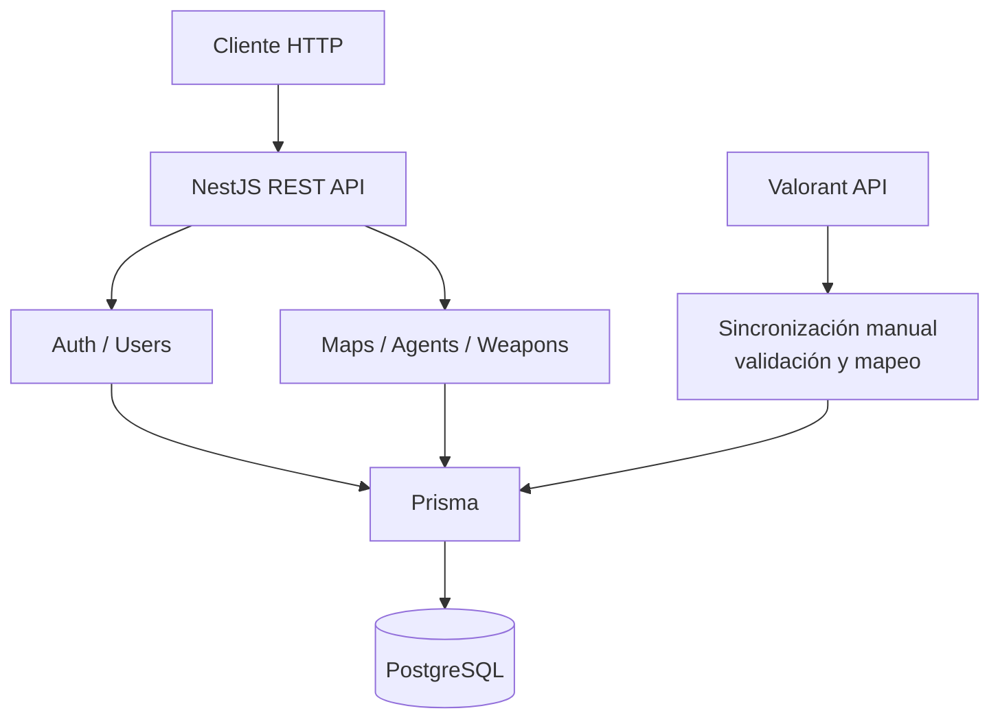
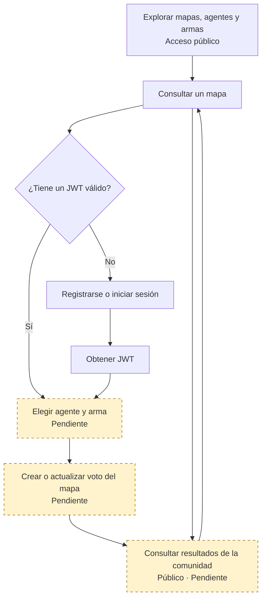
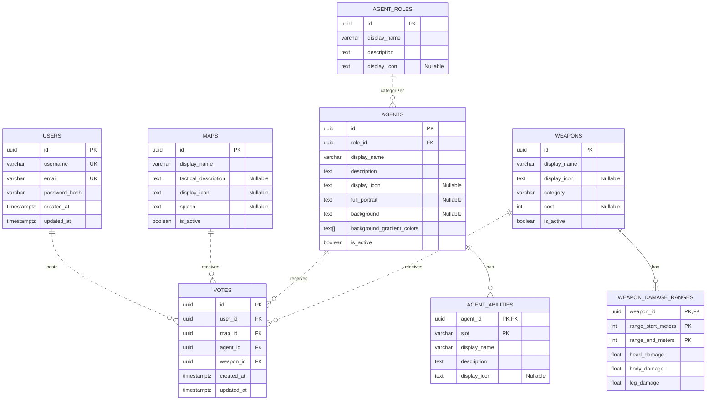

# Documentación técnica

## 1. Arquitectura

Monorepo pnpm con backend NestJS modular y PostgreSQL mediante Prisma. **Implementado:** infraestructura, autenticación y catálogo. **Pendiente:** votaciones, resultados y frontend React/Vite. La guía de uso está en [README.md](README.md).

| Módulo            | Responsabilidad                                                 |
| ----------------- | --------------------------------------------------------------- |
| Health            | Disponibilidad de API y PostgreSQL.                             |
| Auth / Users      | Registro, JWT y acceso a cuentas; sin CRUD público de usuarios. |
| Maps              | Mapas y detalles.                                               |
| Agents            | Agentes, roles de juego y habilidades.                          |
| Weapons           | Armas y rangos de daño.                                         |
| Valorant          | Validar y sincronizar el catálogo; separado del servidor HTTP.  |
| Votes — pendiente | Votos por mapa y resultados agregados.                          |

## 2. Flujo de la aplicación

Flujo previsto del producto: la exploración y autenticación ya funcionan por API; la interfaz web y los pasos marcados como pendientes aún no existen.

## 3. Modelo de datos

ERD contrastado con [schema.prisma](apps/api/prisma/schema.prisma). Usa nombres de modelos/propiedades Prisma; PostgreSQL utiliza tablas y columnas snake_case mediante mappings. Las [migraciones](apps/api/prisma/migrations) añaden CHECK y NOT NULL que Prisma no expresa completamente. La tabla de votos existe, pero su funcionalidad HTTP está pendiente.

| Restricción importante                 | Garantía                                                                                                                                                             |
| -------------------------------------- | -------------------------------------------------------------------------------------------------------------------------------------------------------------------- |
| Email y username normalizados y únicos | Evita cuentas duplicadas, incluso con registros concurrentes.                                                                                                        |
| `UNIQUE(userId, mapId)` en vote        | Un voto por usuario/mapa; permite votar en mapas distintos. La edición atómica del voto sigue pendiente.                                                             |
| PK compuestas de habilidad y daño      | Slot identifica la habilidad dentro del agente; inicio/fin identifica el rango dentro del arma, sin UUID inventados.                                                 |
| Borrado restringido                    | Usuarios/mapas/agentes/armas con votos y roles con agentes no pueden eliminarse; evita alterar el historial. Habilidades y rangos usan cascada desde su propietario. |
| CHECK de costo y daño                  | Costo nulo o no negativo; distancias enteras no negativas, fin mayor que inicio, daños finitos no negativos.                                                         |

IDs y FKs usan UUID nativo: User/Vote los generan localmente; el catálogo conserva los del proveedor. Fechas usan timestamptz; `createdAt` tiene default `now()` y `updatedAt` lo mantiene Prisma. `isActive` inicia en true; colores en array vacío obligatorio. Los roles son categorías de agentes, **no permisos de usuarios**.

## 4. Decisiones técnicas

| Decisión                            | Motivo o compromiso                                                                                                                                                                                                                                                                                                    |
| ----------------------------------- | ---------------------------------------------------------------------------------------------------------------------------------------------------------------------------------------------------------------------------------------------------------------------------------------------------------------------- |
| Módulos por dominio                 | Mantener responsabilidades claras en un monolito; sin repositorios genéricos, microservicios ni módulos separados para habilidades/rangos.                                                                                                                                                                             |
| Catálogo persistido                 | Lecturas independientes del proveedor. Listas solo de activos; detalles incluyen retirados para resolver referencias históricas.                                                                                                                                                                                       |
| Contratos externos separados        | Zod valida JSON antes del mapeo; DTOs públicos y Prisma tienen responsabilidades distintas. Se persisten solo campos seleccionados.                                                                                                                                                                                    |
| Elegibilidad explícita              | Mapas estándar por UUID contrastados con Riot, no por rotación competitiva.                                                                                                                                                                                                                                            |
| Sincronización manual e idempotente | Upserts y reemplazo de dependientes en una transacción para los tres catálogos. Bloqueo PostgreSQL antes de descargar evita ejecuciones superpuestas; ocupa una conexión durante la descarga acotada. Sin scheduler.                                                                                                   |
| Retiradas revisadas                 | Un HTTP 200 no prueba completitud. Ausencias respecto de la línea base o registros activos abortan todo; solo la lista exacta de UUID revisados permite desactivarlos. No se eliminan entidades ni votos. Las colecciones dependientes se consideran completas al validar el contrato, sin garantía externa adicional. |
| JWT y bcrypt                        | Token HS256 con issuer/audience y expiración; sin sesiones ni refresh tokens. Contraseña de 12+ caracteres y hasta 72 bytes UTF-8, sin recortar, NUL ni solo espacios; costo bcrypt 12. Todos los usuarios tienen las mismas capacidades.                                                                              |
| Consistencia de votos — pendiente   | Identidad desde JWT, nunca desde el body; mapa/agente/arma existentes y activos. Crear o editar atómicamente bajo la unicidad compuesta, incluso con concurrencia.                                                                                                                                                     |
| Resultados calculados — pendiente   | Sin tabla agregada: agente y arma usan por separado el total de votos del mapa. Sin votos: total cero y listas vacías. Orden descendente por votos con desempate estable.                                                                                                                                              |
| Pruebas proporcionadas              | Vitest/Supertest, PostgreSQL aislado y fixtures externos. Priorizar reglas y regresiones; sin cobertura porcentual exigida. Mantener concurrencia, rollback y privacidad; evitar duplicar el mismo caso entre capas.                                                                                                   |

## 5. Uso de IA

Se utilizó **Codex, basado en GPT-6**, con terminal, documentación oficial y consultas HTTP. Participó en análisis, implementación, pruebas y documentación; no se delegó a subagentes.

| Responsabilidad    | Participación                                                                                                                                                                                                                        |
| ------------------ | ------------------------------------------------------------------------------------------------------------------------------------------------------------------------------------------------------------------------------------ |
| Decisiones humanas | El usuario definió stack, ocho entidades, reglas de negocio, alcance por fases y autorizó cada continuación. También solicitó reducir redundancia en tests y documentación.                                                          |
| Propuestas de IA   | Configuración compatible con NestJS, parámetros JWT/bcrypt, validación de GUID, bloqueo de sincronización y revisión explícita de retiradas.                                                                                         |
| Validación         | Revisión manual del código y las consultas SQL, verificación de endpoints mediante Postman y Swagger, ejecución de typecheck, lint, compilación, pruebas unitarias y E2E, y comprobación de la sincronización real con Valorant API. |
